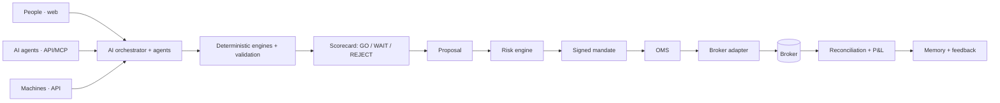

# Satelink Trading AI

**An AI trading operating system for people, AI agents and machines.**
Reason, validate, score, authorize, execute, learn.

> **Status:** Paper trading in controlled beta. Live execution is not yet available.
> Live money stays locked behind code-level flags and a signed real-money gate.

## What it is

Satelink Trading AI is one core with three kinds of client:

- **People** use the web app: describe capital, limits and markets, read a GO / WAIT / REJECT
  decision card with its evidence, and authorise a paper order with a one-time code.
- **External AI agents** use the API or MCP tools: read, evaluate, propose. They are scoped by
  key, budgeted and metered.
- **Machines and bots** use the same API, with the same checks.

Inside, specialised AI agents (market, regime, risk explainer, portfolio, review) reason about the
market. Deterministic engines (features, regime, liquidity, data confidence, walk-forward, stress)
validate. A scorecard returns **GO, WAIT or REJECT** with a confidence and its evidence, and **a
failed hard gate always overrides a high score**. Nothing executes unless the risk engine and a
mandate the user signed allow it. Every step is recorded under one trace so any order can be
explained, and outcomes feed trading memory for review. A strategy never changes itself while live.

It is **not** a signal service, a chatbot, copy trading, a fund, or investment advice.

## Architecture

```
AI proposal → Strategy DSL → validation → deterministic engine → scorecard + hard gates
  → risk engine (20 checks, kill switches) → portfolio check → mandate (TOTP-signed)
  → OMS (exactly-once) → broker adapter → broker → reconciliation → P&L → memory / feedback
```



Full map with file paths, status per subsystem and the 27-question architecture test:
[`docs/trading-agent/ARCHITECTURE.md`](https://github.com/Jakuraa/Satelink_Network/blob/trading-agent/integration/docs/trading-agent/ARCHITECTURE.md) (on the `trading-agent/integration` branch).

## Three interfaces

| Interface | For | Status |
|---|---|---|
| Web | people | paper beta |
| REST API | AI agents, machines | built, not public yet |
| MCP | AI agents | built (read + propose tools only), not public yet |

## Safety boundary

- **AI proposes.** The LLM has no order-placing tool, never sees broker credentials, and cannot
  change risk limits, mandates, billing, ledger or revenue rules.
- **Deterministic risk decides.** Kill switches, limits, data freshness and price collars are fixed
  code. If a check cannot run, the order is refused.
- **Your signed mandate decides.** Orders must fit limits the user signed with a one-time code.
- **You keep custody.** Money stays at the user's broker. Satelink never holds customer funds, and
  withdrawals are never enabled.

## Status

- Paper trading in controlled beta. Live execution is not yet available.
- `LIVE_TRADING`, `AUTONOMOUS_MODE` and `UPSTOX_AUTOMATED` are locked in code. Live money requires
  REAL MONEY GATE 1 (`docs/trading-agent/gates/`).
- Broker connectors (Binance, Upstox, Alpaca) are built for testnet / sandbox / copilot use only.
  Satelink is not affiliated with, endorsed by or a partner of any of them.

Website: [satelink.network](https://satelink.network) · Company: [Jakuraa Commercial Private Limited](https://jakuraa.com)

## Legacy / internal: machine-commerce rails

Satelink also runs pay-per-call infrastructure for software that pays software: derived market
statistics and Polygon JSON-RPC, paid via x402 (USDC on Base) or USDT credit deposits. The node
operator program is paused. Operator payouts are not active.

### Status (honest)

- The gateway is live at `https://rpc.satelink.network` and serves real
  traffic (hundreds of thousands of requests/day, p50 ~50 ms).
- Two payment rails are live on mainnet, and fund the same credit balance for
  both products:
  - **x402** — HTTP 402 challenge/pay flow, USDC on Base (`eip155:8453`),
    settled through the Coinbase CDP facilitator. Mainnet-proven.
  - **USDT credit deposits** — permissionless deposits to RevenueVaultV2 on
    Polygon, credited automatically to your API key.
  - A one-time USD credit pack via Dodo Payments (card/UPI) is the human
    checkout path — see [satelink.network/pricing](https://satelink.network/pricing).
- No free tier: every RPC call is paid — **x402 bundle: $0.10 USDC = 1,000
  calls** (USDC on Base), or **prepaid USDT deposit: $0.00003/call, min
  $0.50** (Polygon). Paid conversion is early. No revenue numbers are
  advertised here — anything you see is on-chain and verifiable.

### Try it (no key needed)

```bash
# RPC — unauthenticated/unfunded calls get a machine-readable 402 with
# everything needed to pay (x402 challenge or deposit instructions); agents
# can self-onboard without a human.
curl -X POST https://rpc.satelink.network/rpc/polygon \
  -H "Content-Type: application/json" \
  -d '{"jsonrpc":"2.0","method":"eth_blockNumber","params":[],"id":1}'

# Intelligence — free discovery metadata only (metrics, prices, how to pay;
# not a free RPC/data allowance)
curl https://rpc.satelink.network/v1/intelligence
```

### Machine-consumer quickstart

1. **Discover the service.** `GET /.well-known/satelink.json` — the machine
   manifest: chain, pricing, payment rails, and the exact onboarding request
   shape. `GET /v1/pricing` — the live rate card the serving path actually
   bills against (tiers, deposit flow, intelligence pricing).
2. **Register (optional — you can also just pay the 402 challenge cold).**
   `POST /v1/machine/register` with `{ wallet_address, signature }` (a
   `personal_sign` of `satelink:register:<lowercase wallet_address>`) →
   returns an `api_key` for the `X-API-Key` header.
3. **Pay.** Either rail credits the same account: an x402 bundle on
   `POST /rpc/polygon` (USDC on Base, no account needed), or a USDT deposit
   to the RevenueVaultV2 address below.
4. **Call.** RPC at `/rpc/<chain>`, intelligence at
   `/v1/intelligence/<metric>` — same API key, same balance, metered per
   call.

```bash
curl https://rpc.satelink.network/.well-known/satelink.json
curl https://rpc.satelink.network/v1/pricing
```

### Ecosystem

- **[x402-kit](https://github.com/Jakuraa/x402-kit)** — standalone,
  MIT-licensed Express middleware that puts an x402 USDC paywall in front of
  any route. Extracted from this codebase, mainnet-proven.
- **MCP server** (`apps/mcp-server`) — gives AI agents Satelink RPC access as
  MCP tools (`satelink-mcp`).

### Contracts (verifiable on-chain)

| Contract | Chain | Address |
|----------|-------|---------|
| RevenueVaultV2 (deposits) | Polygon 137 | `0x577D3716d6Ad5b676d230f5409deF9838FABaCEF` |
| USDT | Polygon 137 | `0xc2132D05D31c914a87C6611C10748AEb04B58e8F` |
| Treasury / x402 payTo | Polygon / Base | `0x966E1Ae22996545015b1414B35234b10719d7Ad4` |

## Stack

- **Backend:** Node.js + Express (`apps/api`), PostgreSQL + Redis, on Railway
- **Frontend:** Next.js (`apps/web`) at [satelink.network](https://satelink.network)
- **Contracts:** Solidity + Foundry (`contracts/`), Polygon PoS mainnet

## Development

```bash
git clone https://github.com/Jakuraa/Satelink_Network.git
cd Satelink_Network && npm install
cd apps/api && npm test   # mocha; see CLAUDE.md for the known-failure baseline
```

> Do not boot the full app against the production database — the schedulers
> write. See `CLAUDE.md` for safe local verification.

## Legal

[Pricing](https://satelink.network/pricing) ·
[Terms of Service](https://satelink.network/terms) ·
[Privacy Policy](https://satelink.network/privacy) ·
[Refund & Cancellation](https://satelink.network/refund) ·
[Contact](https://satelink.network/contact)

## License

MIT

---

[Website](https://satelink.network) · [RPC](https://rpc.satelink.network) · [Intelligence](https://satelink.network/intelligence) · [x402-kit](https://github.com/Jakuraa/x402-kit)
