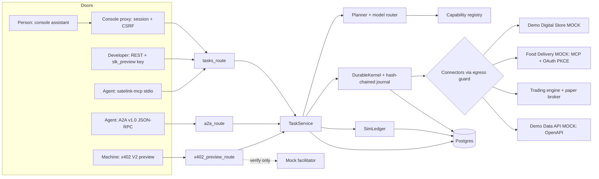

# Satelink AI Assistance — architecture as built (Release State A)

Describes what exists on the `build/*` stack as of 2026-11-09. It is a **local preview**: simulated money, labelled mock
suppliers, not deployed. The separately live RPC and x402 services are out of scope here and were not changed by it.

## One picture



`tools/architecture-tests/one-engine.test.ts` enforces this shape: one `TaskService`, only it builds the workflow engine, and
no surface or connector writes engine or ledger tables.

## Task engine
`apps/api/src/workflows/task_service.js` extends #609's `DurableKernel`/`RoutingKernel`, with one generic adapter
(`TaskStepAdapter`, idempotency key `<txId>:EXECUTE`). Postgres is the source of truth (`workflow_runs`, `wf_journal`,
`workflow_reservations`, `workflow_receipts`). Multi-step quoting exists; execution currently runs step 1 only.

```mermaid
stateDiagram-v2
  [*] --> CREATED --> UNDERSTANDING --> PLANNING
  PLANNING --> AWAITING_INPUT --> PLANNING
  PLANNING --> QUOTED --> AWAITING_APPROVAL
  AWAITING_APPROVAL --> AUTHORIZED: person, pre-authorized key, or exact x402 payment
  AUTHORIZED --> RESERVED --> EXECUTING --> VERIFYING --> SUCCEEDED
  EXECUTING --> UNKNOWN_EXECUTION_OUTCOME: crash or kernel failure
  UNKNOWN_EXECUTION_OUTCOME --> VERIFYING: supplier has the order
  UNKNOWN_EXECUTION_OUTCOME --> REQUIRES_RECONCILIATION: executed, nothing matches
  VERIFYING --> REQUIRES_RECONCILIATION: mismatch
  VERIFYING --> FAILED
  PLANNING --> REJECTED
  AWAITING_APPROVAL --> EXPIRED
  AWAITING_APPROVAL --> CANCELLED
```

**Crash rule:** never re-execute blindly. Recovery marks EXECUTING as UNKNOWN, asks the supplier by idempotency key, then
decides. A verified supplier record is stored if the crashed process never recorded the result. Capture happens only after
verification.

## Capability registry, planner, model router
- `capability_registry.js`: one registry for every surface (console Explore, OpenAPI, MCP tool enums, A2A skills, the website
  JSON, llms.txt). Customer views drop internal entries.
- `planner.js`: the model's plan is untrusted (R7); the server validates it against the registry and input schemas.
- `model_router.js`: conversation vs plan uses built-in verbs plus registry-declared intents. Without `OPENROUTER_API_KEY` it
  uses `FixtureModelProvider`, so **model routing is VERIFIED (FIXTURE), never proven live**.

## Money simulation
- `sim_ledger.js` writes double-entry postings mirroring the Financial OS reservation postings (ADR-5, with a parity test).
  Integer micro-USD (USDC/6), never floats (`no-float-money` rule).
- Hold on reserve; capture only after verification; release otherwise. Every money row carries `origin` + `environment`.
- `revenue_truth` counts only `origin='external' AND environment='live'`, so preview activity cannot be revenue.
- Credits pay only Satelink's fee. Merchant amounts are shown as paid by the user at the merchant. Fees in
  `config/pricing.preview.json` are PROPOSED — NOT APPROVED.
- x402 preview: the verified mock payment for the exact quote is the approval; it books one simulated deposit per task, then
  the normal reserve → capture runs. The amount covers only the Satelink fee.

## Connectors
All outbound HTTP goes through `connectors/egress_guard.js` (preview: loopback only; beta/live mode: https and no private,
link-local or metadata targets; redirects always refused). DNS rebinding is not yet handled.

| Connector | Protocol | Journey | Idempotent on | Status |
|---|---|---|---|---|
| `mock_store` | REST | S1 shopping | supplier key | local mock |
| `mcp_food` | MCP + OAuth 2.1 PKCE, tokens AES-256-GCM | S2 food | supplier key | local mock, not connected to Swiggy |
| `trading_engine` | in-process | S3 | deterministic evaluation per quote | synthetic data, paper only |
| `rest_openapi_data` | REST, driven by the provider's OpenAPI | S4–S6 | supplier key | local mock |

## Protocol surfaces
- **REST**: `/v1/*`, generated `/v1/openapi.json`; hashed, scoped, revocable keys (`developer_api_keys`); API-key approvals
  require `Idempotency-Key`.
- **MCP**: `satelink-mcp` 2.2.0, stdio only, tools generated from the registry; no approve tool. Negotiates 2025-11-25: the
  official SDK does not support 2026-07-28 yet (OB-13). Not published.
- **A2A v1.0**: Agent Card + JSON-RPC (`SendMessage`, `GetTask`, `CancelTask`; others → -32004). Card unsigned.
- **x402 V2 preview**: official `@x402/core` codecs, testnet id, placeholder `payTo`, local mock facilitator with no `/settle`.
  A test proves no live x402, vault or RPC credit module is reachable from the preview server.

## Agent spend
`agent_spend_preauth_minor` defaults to 0 per key. A task with `actor_type = agent` is approvable by a key only up to it, so
by default only a person approves. There is no UI to raise it.

## Trading
`trading_connector.js` compiles a strategy, runs walk-forward evaluation with costs and a look-ahead check on a **synthetic
dataset**, applies deterministic GO/WAIT/REJECT rules with a trace, and paper-fills GO only (`InternalPaperBroker`). Every
result carries `SIMULATED_PAPER_EXECUTION: NOT_ACTUAL_RETURNS`. The Alpaca adapter is pinned to the paper host and refuses
the live host; it has not been run against Alpaca (no keys). No Indian broker orders exist.

## Surfaces only in preview
`preview_release_a.mjs` is the only server that mounts `/v1` tasks, A2A and x402 preview. Console pages need
`SATELINK_PREVIEW=1` (404 otherwise); dev mail sink and auth preview switches are refused in production.

## Migrations
`042`–`046` are additive and have down scripts: ledger kinds, task lifecycle + simulated money + `revenue_truth`, connector
connections, developer keys, agent pre-authorization. **None has been applied to production.**
